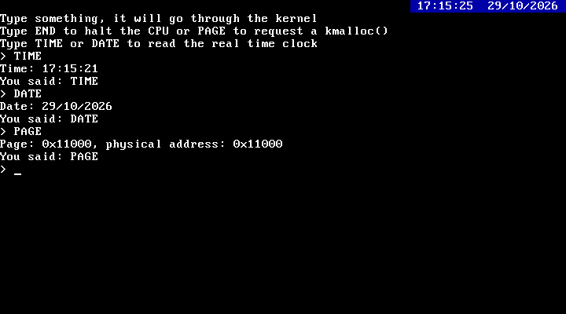

*Concepts you may want to Google beforehand: CMOS, RTC, BCD*

**Goal: Read the real date and time from the hardware and show a clock on screen**

Our kernel can count ticks since boot thanks to the timer from lesson 20, but
it has no idea what time it actually is. Every PC has a small battery powered
chip called the CMOS, which keeps a Real Time Clock (RTC) running even when the
computer is off. Let's read it!




Talking to the CMOS
-------------------

The CMOS is accessed through two I/O ports, just like we did with the screen
in lesson 15:

- Port `0x70`: we write the number of the register we want to read
- Port `0x71`: we read the value of that register

The registers we care about are:

| Register | Value   |
|----------|---------|
| `0x00`   | Seconds |
| `0x02`   | Minutes |
| `0x04`   | Hours   |
| `0x07`   | Day     |
| `0x08`   | Month   |
| `0x09`   | Year (only the last two digits) |
| `0x0A`   | Status register A |
| `0x0B`   | Status register B |

Open `drivers/rtc.c`. `read_register()` does the two port operations, and
`read_rtc()` fills a `rtc_time_t` struct with all the values.

The RTC updates its values once per second, and if we read them right in the
middle of an update we may get a mix of old and new values. Bit 7 of status
register A is set while an update is in progress, so we just wait in a loop
until it is clear before reading.


BCD
---

If you print the raw seconds you will see weird numbers like 89 after 59.
That's because the RTC usually stores values in BCD (Binary Coded Decimal),
where each decimal digit takes 4 bits. So `0x59` means 59, not 89.

Bit 2 of status register B tells us if the values are already binary.
If not, we convert them with `bcd_to_binary()`, which takes the low 4 bits
as the units and the high 4 bits as the tens.

Note: the RTC may also be in 12 hour mode, but QEMU and most machines use 24 hour
mode by default, so we don't handle that for now.


Printing the time
-----------------

`time_to_ascii()` and `date_to_ascii()` turn the struct into strings like
`17:15:21` and `29/10/2026`. We always print two digits for every field,
otherwise 5 seconds would show as `17:15:5`.


A clock on the screen
---------------------

We want a clock on the top right corner that keeps updating by itself.
The timer interrupt is perfect for that: on `cpu/timer.c` we call `show_clock()`
once every 50 ticks, which is one second since `irq_install()` sets the timer
to 50Hz.

We can't use `kprint_at()` for this, because it moves the cursor, and the
user would end up typing next to the clock! So we add `kprint_at_color()` to
`drivers/screen.c`, which writes directly into video memory with any color we
want and leaves the cursor alone. We also add a new `WHITE_ON_BLUE` color on
`screen.h`.

On `kernel/kernel.c` we clear the screen at startup and leave the first line for
the clock. We removed the `int $2` and `int $3` tests from lesson 18 since we
know interrupts work by now.


New commands
------------

Two new commands were added to `user_input()`:

- `TIME` prints the current time
- `DATE` prints the current date

Run `make run`. QEMU uses UTC by default, if you want your local time use:

```
qemu-system-i386 -fda os-image.bin -rtc base=localtime
```

The rest of the files are unchanged from last lesson.
